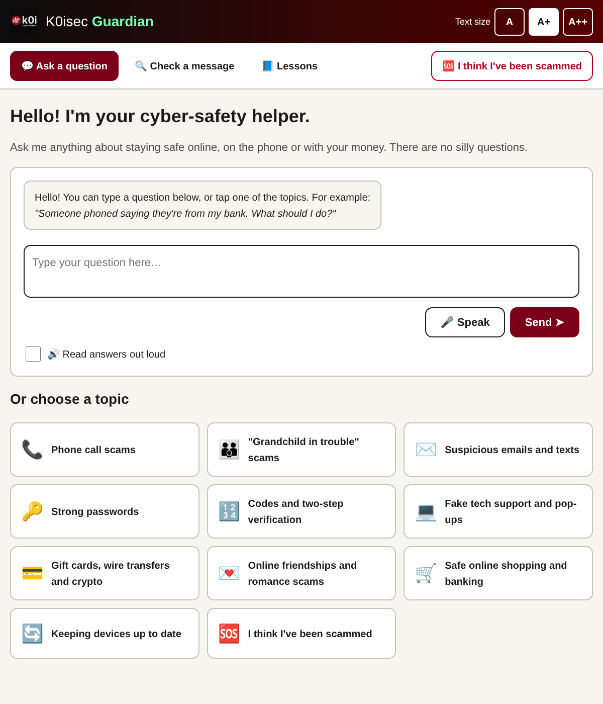
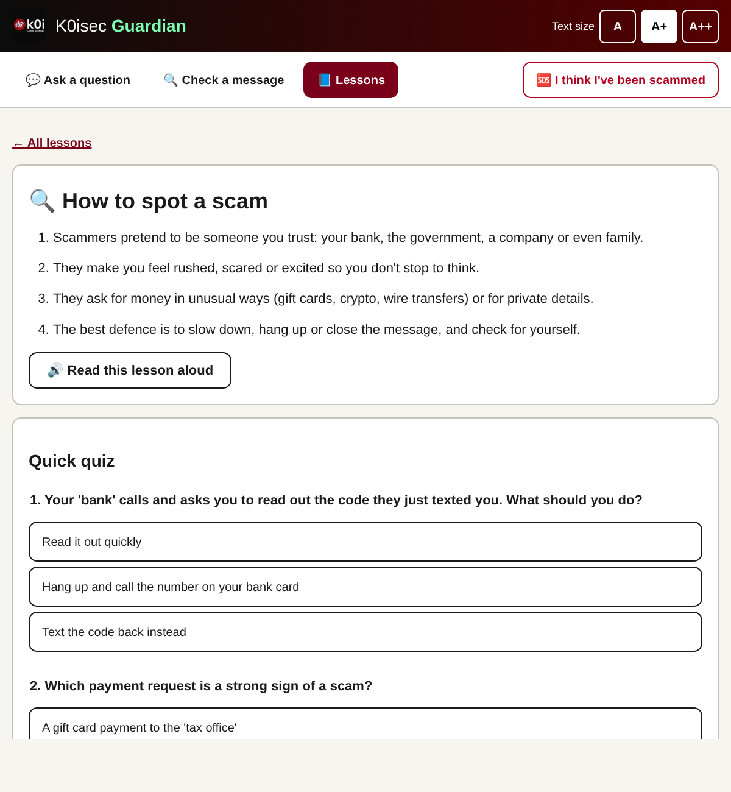

# K0isec Guardian - Capstone Project Report

**Author:** Bismark Koima
**Project:** An offline AI cyber-safety assistant for older adults

---

## 1. Problem statement

Older adults are frequent targets of fraud such as phishing emails and texts, fake tech-support calls,
"grandchild in trouble" calls, romance scams and demands for payment in gift cards. Many existing security
tools are built for technical users: they use jargon, small text and complex settings, and AI chatbots
usually send everything the user types to cloud servers - a privacy concern for people discussing their
finances and personal details.

### The scale of the problem

- **United States - FBI.** The FBI's Internet Crime Complaint Center (IC3) reported that people aged 60 and
  over lost nearly **$4.9 billion** to online fraud in 2024, about **43% more than in 2023**, and that this
  age group filed more complaints than any other [1]. For 2023, the FBI's Elder Fraud Report had recorded
  more than 101,000 victims aged 60+ and over $3.4 billion in losses [2].
- **United States - FTC.** The Federal Trade Commission's *Protecting Older Consumers 2024-2025* report found
  that fraud losses reported by people 60 and over grew roughly fourfold, from about $600 million in 2020 to
  **$2.4 billion in 2024**, driven largely by individual losses above $100,000 to investment, romance and
  impersonation scams [3]. Because most fraud goes unreported, the FTC estimated the true cost to older adults
  in 2024 at between **$10.1 billion and $81.5 billion** [3]. The FTC also found that older adults report
  much higher median losses than younger adults, especially people aged 80 and over [3].
- **Kenya.** The Communications Authority of Kenya detected about **4.56 billion cyber threat events** in
  October-December 2025, and it linked the rise partly to low awareness of phishing and to criminals'
  growing use of AI [4]. Mobile-money scams such as fake "sent to you by mistake" reversal requests are a
  familiar local example. Section 7 uses messages like these as test cases.

These figures point to two things. Older adults lose more money per incident than other groups, and much
fraud depends on **social engineering**: persuading the victim to act, rather than breaking technology.
Education that helps people recognise manipulation tactics is therefore a direct, low-cost defence.

### Gaps in existing tools

1. **Usability.** Security advice and tools often assume technical knowledge and use small text and
   jargon, which excludes many older users. WCAG 2.2 sets out accessibility needs such as resizable text,
   sufficient contrast and clear focus indicators [5].
2. **Privacy.** Cloud chatbots send what the user types to remote servers. People asking "is this message
   from my bank real?" often paste exactly the personal and financial details they should protect.
3. **Explanation.** Spam filters block or allow messages silently. They don't teach users *why* a message
   is dangerous, so users learn nothing for the next scam that gets through.

K0isec Guardian addresses all three by combining an accessible interface, an AI model that runs entirely on
the user's own computer, and checks that explain every warning sign.

## 2. Aim and objectives

**Aim:** build an easy-to-use assistant that teaches older adults how to recognise and respond to scams,
while keeping their conversations completely private.

**Objectives**
1. Provide a conversational assistant that answers safety questions in plain, reassuring language.
2. Run the AI model **offline** on the user's own computer, so no data leaves the device.
3. Keep working even without an AI model, using a built-in safety guide.
4. Let users paste a suspicious message and get an explained risk rating.
5. Teach core skills through short lessons and quizzes.
6. Meet accessibility needs of older users (large text, high contrast, read-aloud, simple navigation).
7. Follow secure-development practice (no secrets in code, input validation, security headers, tests).

## 3. Target users

- Adults aged roughly 60+ with basic computer or tablet experience.
- Family members or carers who set the app up and want to help a relative stay safe.
- Community centres, libraries or churches running digital-skills sessions.

## 4. Requirements

### Functional
| ID | Requirement | Where implemented |
|---|---|---|
| F1 | Answer safety questions in a chat | `guardian/assistant.py`, `templates/index.html` |
| F2 | Use a local, offline LLM | `guardian/llm.py` (Ollama) |
| F3 | Fall back to a built-in guide when no model is available | `guardian/knowledge.py` |
| F4 | Analyse a pasted message for scam warning signs | `guardian/scam_checker.py`, `/check` |
| F5 | Lessons with quizzes and progress | `guardian/lessons.py`, `static/lessons.js` |
| F6 | Emergency "I've been scammed" guidance | `templates/help.html` |
| F7 | Quick topic buttons for common scams | `templates/index.html` |

### Non-functional
| ID | Requirement | How it is met |
|---|---|---|
| N1 | Privacy | Offline model; server bound to `127.0.0.1`; no logging or storing of messages; personal numbers kept only in the browser |
| N2 | Accessibility | Large 20px text by default, 3 text sizes (16/20/24px), high contrast, dark mode, ≥44px tap targets, focus outlines, skip link, ARIA live regions, read-aloud |
| N3 | Works on ordinary hardware | Small 2-4B parameter models; guide-only mode needs no model at all |
| N4 | Security | Strict Content-Security-Policy, no inline scripts, `textContent` only (no HTML injection), input length limits, request size limit, no secrets in the repository |
| N5 | Reliability | Every chat request returns an answer, even if the model fails |
| N6 | Maintainability | Small modules, automated tests, CI on GitHub Actions |

## 5. System design

### Architecture

```
Browser UI ──HTTP──► Flask (app.py)
                       ├─ Assistant ──► OfflineLLM ──► Ollama (local model)
                       │       └──────► Knowledge base (fallback + reference notes)
                       ├─ Scam checker (rules + link analysis)
                       └─ Lessons
```

### Key design decisions

**Offline LLM via Ollama.** Ollama packages open models (Llama 3.2, Phi-3, Gemma 2, Qwen 2.5) behind a
simple local HTTP API [6]. The client uses only the Python standard library, keeping dependencies minimal.
The default model, `llama3.2:3b`, is small enough for an ordinary laptop.

**Retrieval of trusted notes.** Small models can make mistakes, so before calling the model the assistant
finds matching topics in the hand-written safety guide and runs the scam checker on the question. These are
passed to the model as reference material, grounding its answers in vetted advice.

**Graceful fallback.** If Ollama is not installed, the model isn't downloaded, or a request fails/times out,
the user still gets a useful answer from the guide. The footer shows which mode is in use.

**Explainable scam checker.** Rather than a black-box score, the checker uses transparent rules (urgency,
threats, requests for codes/passwords, unusual payment methods, secrecy, "hi mum" messages, remote-access
requests, fake deliveries) and link analysis (shorteners, IP-address links, unusual domain endings,
look-alike brand domains, punycode). Each warning is explained in plain words, so every check is also a
small lesson. Requests for codes, gift-card/crypto payments, or remote access are always rated high risk.

**Prompt design.** The system prompt asks for short answers, plain words, a warm tone, numbered steps,
never requesting private details, staying on topic, and admitting uncertainty. Only `user`/`assistant`
turns are accepted from the browser's history, so a client cannot inject extra system instructions.

## 6. Implementation

- **Language/framework:** Python 3, Flask, Jinja2, vanilla JavaScript, CSS.
- **AI runtime:** Ollama (any compatible local model).
- **Testing:** `unittest`-style tests run with pytest; GitHub Actions CI.
- **Security headers** follow OWASP Secure Headers guidance [9]; the web layer uses Flask [10].
- **Evaluation tools:** `evaluation/evaluate_checker.py` (accuracy), `evaluation/compare_models.py`
  (model comparison), `evaluation/USER_TESTING.md` (usability study kit).

Screenshots:

| Home / chat | Lesson & quiz |
|---|---|
|  |  |

## 7. Testing and evaluation

### Automated tests (28 tests)
- **Scam checker:** phishing email, "hi mum" gift-card message, code requests, remote access,
  harmless message, real vs. look-alike domains, link shorteners, empty/huge input.
- **Knowledge base:** topic matching for typical questions, fallback answer, valid quiz answers.
- **Assistant:** uses the model when available, passes reference notes, filters/trims history,
  falls back when the model is missing or errors.
- **Web app:** every page loads with security headers, 404 handling, API validation.
- **Evaluation set:** the labelled dataset is well-formed and balanced, and the checker's accuracy on it
  must not fall below 85% (regression guard).

### Scam checker accuracy

**Method.** A labelled set of **50 short messages** (`evaluation/messages.json`) was written to cover typical
scams aimed at older adults: 25 scams (phishing, fake deliveries, "hi mum" and grandchild scams, code
requests, tech support, prizes, romance, investment, police/tax impersonation, mobile-money reversal) and
25 genuine messages (family, appointments, bank and utility notices, one-time-code texts, M-Pesa receipts,
community news). A message counts as *flagged* when the checker rates it medium or high risk. Run with
`python -m evaluation.evaluate_checker`.

**Results.**

|                     | Flagged | Not flagged |
|---------------------|--------:|------------:|
| **Scam (25)**       | 23 (TP) | 2 (FN)      |
| **Genuine (25)**    | 3 (FP)  | 22 (TN)     |

| Metric    | Value |
|-----------|------:|
| Accuracy  | 90.0% |
| Precision | 88.5% |
| Recall    | 92.0% |
| F1 score  | 90.2% |

Of the 25 scams, 20 were rated *high* risk and 3 *medium*. 22 of the 25 genuine messages were rated *low*.

**Error analysis.**

| Message (shortened) | True label | Rated | Why |
|---|---|---|---|
| "Ksh 4,500 sent to you by mistake. Please send it back… urgently for hospital" | scam | low | Only the urgency rule fired. There is no rule yet for "sent by mistake" reversal requests. |
| "I am a financial adviser… earn 15% a week… completely safe" | scam | low | No rule for unrealistic investment returns. |
| "Hi Grandpa, happy birthday!…" | genuine | medium | The "Hi grandma/grandpa" family-scam pattern matched a real greeting. |
| "Your verification code is 482913. Never share this code…" | genuine | high | Any mention of a verification code is rated high, even in a genuine code text. |
| "We will never ask you for your PIN or password…" | genuine | medium | The words PIN/password matched, although the bank was *warning* the customer. |

The false negatives are the more serious errors, because a scam rated *low* could reassure a user. Both
point to missing rules (mobile-money reversals and investment promises) rather than faulty ones. The false
positives are cautious errors: the user is told to check independently, which is still safe advice.

**Threats to validity.** The messages were written by the project author, who also wrote the rules, so the
results are likely optimistic. The set is small, and the rules were not tuned on it after measurement, so
these figures are an honest baseline. A fair final evaluation should use real, anonymised messages from an
independent source and a separate held-out set.

### Usability study with older adults

**Method.** The full kit is in `evaluation/USER_TESTING.md`: consent statement, seven tasks, results sheet
and questionnaire. 5-10 participants aged 60+ each complete these tasks: make the text bigger, ask a
question, check three sample messages (two scams and one genuine), complete a lesson and its quiz, and
find the emergency help page. For each task, completion (unaided / with a hint / not completed) and time
are recorded. Participants then fill in the System Usability Scale (SUS), a standard 10-item questionnaire
scored from 0 to 100 [7]. A score of about 68 is average across many studies [8].

**Success criteria.** At least 80% of tasks completed without help, a mean SUS score of 68 or more, and
every participant able to identify both scam messages.

**Results.** *Pending: to be added after the sessions.* Record participant results, mean SUS score and
key comments here.

| Measure | Result |
|---|---|
| Participants | - |
| Tasks completed without help | - |
| Mean SUS score | - |
| Scam messages correctly identified | - |
| Main feedback themes | - |

### Offline model comparison

**Method.** `python -m evaluation.compare_models llama3.2:3b phi3:mini gemma2:2b` asks each installed model
the same ten safety questions through the full assistant pipeline. It records each answer, its length and
its response time in `evaluation/model_results.csv`. Each answer is then rated from 1 to 5 for
**accuracy** (correct, safe advice) and **simplicity** (plain words, short steps).

**Selection criteria.** The default model should average at least 4/5 on accuracy, never give unsafe
advice (for example telling a user to share a code or pay a caller), and answer within about 15 seconds
on the target laptop.

**Results.** *Pending: to be run on the target laptop with Ollama installed.*

| Model | Size | Avg. accuracy (1-5) | Avg. simplicity (1-5) | Avg. response time | Unsafe answers |
|---|---|---|---|---|---|
| llama3.2:3b | ~2.0 GB | - | - | - | - |
| phi3:mini | ~2.2 GB | - | - | - | - |
| gemma2:2b | ~1.6 GB | - | - | - | - |

## 8. Limitations

- Rule-based detection can miss new scam wording and may flag some genuine messages. The evaluation found
  missed mobile-money reversal and investment scams, and false alarms on genuine one-time-code texts and
  bank warnings.
- The accuracy evaluation uses a small, self-written dataset, so real-world accuracy is likely lower.
- Small local models can still be wrong; answers are grounded but not guaranteed.
- Voice input depends on the browser and may use an online speech service in some browsers.
- Content is currently English-only.

## 9. Future work

- New checker rules for problems found in the evaluation: "sent by mistake" reversal requests,
  unrealistic investment returns, and recognising genuine code texts ("never share this code").
- Additional languages (e.g. Swahili) and region-specific reporting contacts.
- Screenshot/photo upload with offline OCR to check messages from a phone.
- Fully offline speech recognition (e.g. Whisper running locally).
- Packaging as a one-click desktop installer for non-technical users.
- A "trusted contact" mode to share a check result with a family member.

## 10. Ethics and privacy

- No personal data is collected, stored on a server, or sent to third parties.
- The app gives educational guidance only and tells users to contact their bank and the police when money
  is involved.
- Language is respectful and avoids blaming victims.

## 11. Conclusion

Older adults lose more money to fraud than any other age group, and most of these scams succeed through
manipulation rather than technical attacks [1][3]. K0isec Guardian responds with education that is
accessible, private and explained.

| Objective | Outcome |
|---|---|
| 1. Plain-language assistant | Achieved. The chat uses an elderly-friendly prompt, numbered steps and read-aloud. |
| 2. Offline AI | Achieved. Answers come from a local Ollama model, and nothing leaves the computer. |
| 3. Works without a model | Achieved. The built-in guide answers when no model is available, and tests cover this path. |
| 4. Explained message checks | Achieved. 90% accuracy and 92% recall on a 50-message baseline, with every warning explained. |
| 5. Lessons and quizzes | Achieved. Four lessons with quizzes and saved progress. |
| 6. Accessibility | Implemented following WCAG 2.2 guidance. Confirmation by the usability study is pending. |
| 7. Secure development | Achieved. Secrets removed from the repository, input validation, CSP and security headers, 28 automated tests and CI. |

The project shows that a small open model running on an ordinary laptop, grounded by a curated safety
guide, can give useful cyber-safety advice without the privacy cost of cloud AI services. It also shows
that simple, transparent rules can detect most common scam messages while teaching the user why each one
is dangerous. The main lessons from the evaluation are that rule-based detection needs regular updates
for local scam types (such as mobile-money reversal scams) and that results on self-written test data
must be confirmed with real messages and real users. The usability study and model comparison above are
the next steps to confirm that the design works for its intended users.

## References

[1] Federal Bureau of Investigation, Internet Crime Complaint Center. *2024 IC3 Annual Report*. April 2025.
https://www.ic3.gov/AnnualReport/Reports/2024_IC3Report.pdf

[2] Federal Bureau of Investigation, Internet Crime Complaint Center. *2023 Elder Fraud Report*. April 2024.
Available from https://www.ic3.gov

[3] Federal Trade Commission. *Protecting Older Consumers 2024-2025: A Report of the Federal Trade
Commission*. December 2025. https://www.ftc.gov/system/files/ftc_gov/pdf/P144400-OlderAdultsReportDec2025.pdf

[4] Communications Authority of Kenya, quarterly cyber security statistics for October-December 2025, as
reported in "Kenya: Cyber Threats Surge 441pc to 4.56bn On Digital Growth". AllAfrica, April 2026.
https://allafrica.com/stories/202604070388.html

[5] World Wide Web Consortium (W3C). *Web Content Accessibility Guidelines (WCAG) 2.2*. W3C Recommendation,
October 2023. https://www.w3.org/TR/WCAG22/

[6] Ollama. *Ollama API documentation*. https://github.com/ollama/ollama/blob/main/docs/api.md
and Meta. *Llama 3.2 model card*. https://huggingface.co/meta-llama/Llama-3.2-3B-Instruct

[7] Brooke, J. (1996). "SUS: A 'quick and dirty' usability scale". In P. W. Jordan et al. (Eds.),
*Usability Evaluation in Industry*, pp. 189-194. Taylor & Francis.

[8] Sauro, J. (2011). *A Practical Guide to the System Usability Scale: Background, Benchmarks & Best
Practices*. Measuring Usability LLC.

[9] OWASP Foundation. *OWASP Secure Headers Project*. https://owasp.org/www-project-secure-headers/

[10] Pallets Projects. *Flask documentation*. https://flask.palletsprojects.com/
